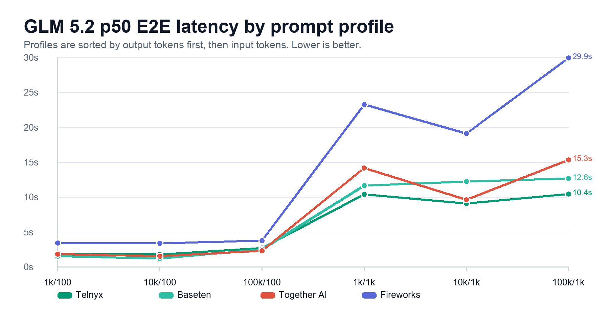
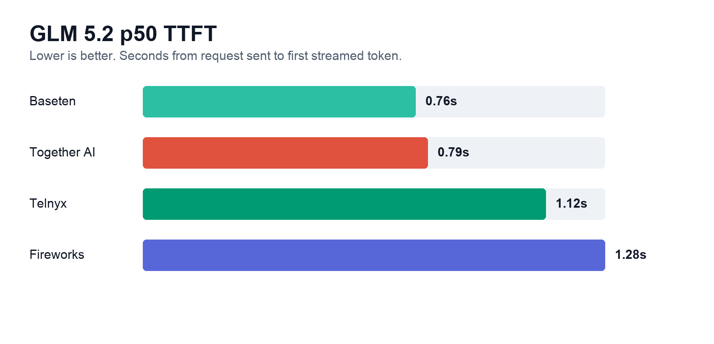
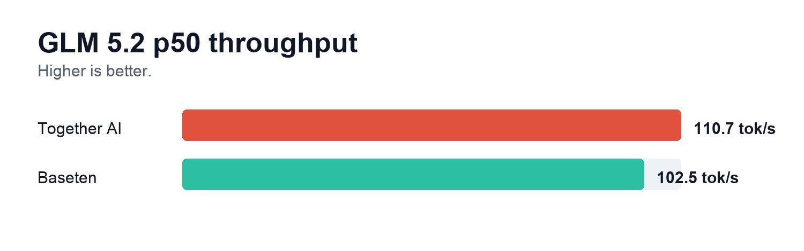

# LLM Inference Benchmarks

This report compares GLM 5.2 inference latency across Telnyx, Baseten, Together AI, and Fireworks using the same six prompt profiles and 10 streamed runs per provider/profile cell.

The raw run had transient failures on Telnyx and Baseten, but each failed provider/profile/iteration slot had a successful retry and was deduped into the clean dataset.

## E2E latency

End-to-end latency is the time from sending the request until the final streamed token is received. Lower E2E latency is better for full-response experiences because it captures both startup time and generation time.

Telnyx and Baseten are effectively tied on overall p50 E2E latency in this GLM 5.2 run: Telnyx is lowest at 6.00s, and Baseten is close at 6.19s. Together AI follows at 7.49s. Fireworks is materially slower overall at 14.98s, driven by slower long-output profiles.

| Provider | Model ID | n | p50 | p95 | mean | max |
| --- | --- | --- | --- | --- | --- | --- |
| Telnyx | `zai-org/GLM-5.2` | 60 | 6.00s | 10.81s | 8.07s | 128.73s |
| Baseten | `zai-org/GLM-5.2` | 60 | 6.19s | 15.97s | 7.49s | 29.86s |
| Together AI | `zai-org/GLM-5.2` | 60 | 7.49s | 30.09s | 9.69s | 69.44s |
| Fireworks | `accounts/fireworks/models/glm-5p2` | 60 | 14.98s | 34.37s | 14.85s | 48.34s |

p50 E2E latency by profile:

| Provider | 1k/100 | 10k/100 | 100k/100 | 1k/1k | 10k/1k | 100k/1k |
| --- | --- | --- | --- | --- | --- | --- |
| Telnyx | 1.77s | 1.76s | 2.68s | 10.36s | 9.07s | 10.44s |
| Baseten | 1.53s | 1.21s | 2.49s | 11.62s | 12.20s | 12.63s |
| Together AI | 1.80s | 1.54s | 2.32s | 14.14s | 9.59s | 15.32s |
| Fireworks | 3.39s | 3.38s | 3.74s | 23.24s | 19.08s | 29.93s |

## TTFT

TTFT measures how quickly the first non-empty streamed model activity arrives after a request is sent. That activity may be reasoning rather than visible answer text. Lower TTFT is better when an application can use or expose the first streamed activity.

Baseten has the fastest overall p50 TTFT at 0.76s, with Together AI close at 0.79s. Telnyx is next at 1.12s, and Fireworks is slower at 1.28s.

| Provider | Model ID | n | p50 | p95 | mean | max |
| --- | --- | --- | --- | --- | --- | --- |
| Baseten | `zai-org/GLM-5.2` | 60 | 0.76s | 4.29s | 1.07s | 5.51s |
| Together AI | `zai-org/GLM-5.2` | 60 | 0.79s | 4.88s | 1.38s | 5.33s |
| Telnyx | `zai-org/GLM-5.2` | 60 | 1.12s | 2.44s | 1.49s | 5.97s |
| Fireworks | `accounts/fireworks/models/glm-5p2` | 60 | 1.28s | 4.71s | 2.18s | 17.60s |

p50 TTFT by profile:

| Provider | 1k/100 | 10k/100 | 100k/100 | 1k/1k | 10k/1k | 100k/1k |
| --- | --- | --- | --- | --- | --- | --- |
| Telnyx | 0.75s | 1.15s | 1.91s | 0.74s | 1.03s | 2.03s |
| Baseten | 0.43s | 0.66s | 1.28s | 0.40s | 0.66s | 1.32s |
| Together AI | 0.54s | 0.67s | 1.27s | 0.82s | 0.66s | 1.32s |
| Fireworks | 1.28s | 1.30s | 2.10s | 0.68s | 1.26s | 1.65s |

## Methodology

- Model IDs: Telnyx, Baseten, and Together AI used `zai-org/GLM-5.2`; Fireworks used `accounts/fireworks/models/glm-5p2`.
- Prompt set: same six benchmark profiles used in the previous inference benchmarking setup.
- Profile order in detailed tables: sorted first by expected output tokens, then by input tokens: 1k/100, 10k/100, 100k/100, 1k/1k, 10k/1k, 100k/1k.
- Iterations: 10 successful streamed runs per provider/profile cell in the clean dataset.
- Metrics: E2E latency, TTFT, median inter-token latency, and effective token throughput where output token usage was returned.
- Caveat: throughput is available only for Together AI and Baseten because Telnyx and Fireworks did not return streamed token usage for this model.
- Caveat: the raw run had transient failures: Telnyx returned one 503 and several temporary `model currently unavailable` errors on the heaviest profile; Baseten returned one 429. A retry pass produced successful rows for those slots.
- Caveat: some Baseten responses stopped before the requested output budget, including a few one-token completions. This can make E2E latency look better on those rows and should be reviewed before using max or per-profile figures as headline numbers.

## Appendix: Throughput

Throughput measures generated output tokens per second after the first token arrives. Higher throughput is better for long generations, but it requires reliable streamed usage/output token counts from the provider.

Among providers with usage data, Together AI has the higher p50 throughput at 110.7 tok/s, followed by Baseten at 102.5 tok/s.

| Provider | Model ID | n | p50 | p95 | mean | max |
| --- | --- | --- | --- | --- | --- | --- |
| Together AI | `zai-org/GLM-5.2` | 60 | 110.7 tok/s | 173.9 tok/s | 110.2 tok/s | 192.4 tok/s |
| Baseten | `zai-org/GLM-5.2` | 60 | 102.5 tok/s | 117.5 tok/s | 97.4 tok/s | 153.5 tok/s |
| Telnyx | `zai-org/GLM-5.2` | 0 | n/a | n/a | n/a | n/a |
| Fireworks | `accounts/fireworks/models/glm-5p2` | 0 | n/a | n/a | n/a | n/a |

p50 throughput by profile where token counts were available:

| Provider | 1k/100 | 10k/100 | 100k/100 | 1k/1k | 10k/1k | 100k/1k |
| --- | --- | --- | --- | --- | --- | --- |
| Telnyx | n/a | n/a | n/a | n/a | n/a | n/a |
| Baseten | 96.6 tok/s | 106.4 tok/s | 92.4 tok/s | 106.8 tok/s | 102.3 tok/s | 107.2 tok/s |
| Together AI | 110.6 tok/s | 138.8 tok/s | 141.0 tok/s | 90.7 tok/s | 134.3 tok/s | 94.4 tok/s |
| Fireworks | n/a | n/a | n/a | n/a | n/a | n/a |
