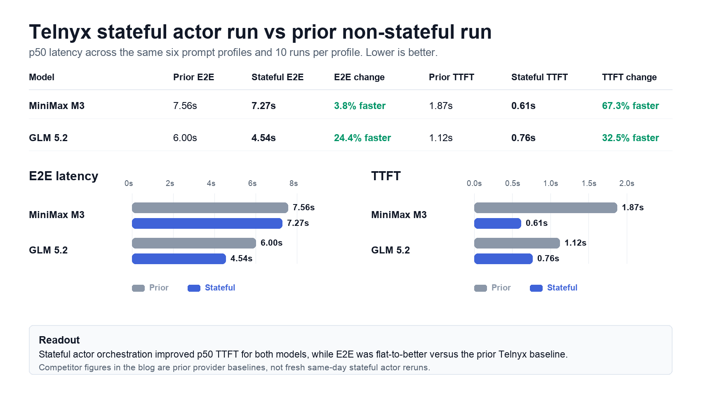

# Running Repeatable LLM Latency Benchmarks with Telnyx stateful actors

Developers building AI applications care about more than model availability. They care about how quickly a model starts responding, how long the full answer takes, and whether those numbers stay predictable as prompts and outputs get larger.

That is where repeatable benchmarking gets useful. A single request can tell you whether an endpoint works. A benchmark run can show how an inference workflow behaves across prompt sizes, output lengths, streaming responses, and retries.

[Telnyx stateful actors](https://developers.telnyx.com/docs/edge-compute/stateful-actors) are long-running, state-aware compute units for workflows that need to remember progress between requests. For inference workloads, that means an actor can own a job, track each model call, store timing metadata, and expose a clean way to poll or export results.

In this run, we used stateful actors to orchestrate Telnyx-hosted [MiniMax M3](https://www.minimax.io/models/text/m3) and [GLM 5.2](https://z.ai/blog/glm-5.2) benchmark requests from Telnyx infrastructure.

## What we measured

We focused on two user-facing latency metrics:

- **E2E latency:** time from request sent to final streamed token received.
- **TTFT:** time from request sent to first non-empty streamed model activity. That activity may be reasoning rather than visible answer text.

For both metrics, lower is better. E2E latency matters when your app needs the full response before moving forward. TTFT describes when streaming begins; it should not be read as time to first visible answer when reasoning is present.

The benchmark used the same six prompt profiles from the earlier runs:

- 1k input / ~100 output
- 1k input / ~1k output
- 10k input / ~100 output
- 10k input / ~1k output
- 100k input / ~100 output
- 100k input / ~1k output

Each model ran 10 repeats per profile.

## Telnyx stateful actor run vs prior Telnyx baseline

The clearest story is the Telnyx-to-Telnyx comparison: prior non-stateful benchmark run versus the latest stateful actor run.

| Model | Prior E2E | Stateful E2E | E2E change | Prior TTFT | Stateful TTFT | TTFT change |
|---|---:|---:|---:|---:|---:|---:|
| MiniMax M3 | 7.56s | **7.27s** | **3.8% faster** | 1.87s | **0.61s** | **67.3% faster** |
| GLM 5.2 | 6.00s | **4.54s** | **24.4% faster** | 1.12s | **0.76s** | **32.5% faster** |

The largest improvement showed up in TTFT. MiniMax M3 moved from 1.87s to 0.61s p50 TTFT, while GLM 5.2 moved from 1.12s to 0.76s. E2E latency also improved: MiniMax M3 was roughly flat-to-better, and GLM 5.2 improved materially.

## How this stacks up against prior provider baselines

We also compared the latest Telnyx stateful actor results against the earlier provider benchmark baselines. This is useful context, but it should be read carefully: competitors were not rerun through Telnyx stateful actors in this latest pass.

| Model | Provider | p50 E2E | p95 E2E | p50 TTFT | p95 TTFT |
|---|---|---:|---:|---:|---:|
| **MiniMax M3** | **Telnyx stateful** | **7.27s** | **12.54s** | **0.61s** | **1.81s** |
| MiniMax M3 | Together AI | 7.77s | 19.35s | 1.57s | 6.29s |
| MiniMax M3 | Fireworks | 8.52s | 54.06s | 3.25s | 52.93s |
| **GLM 5.2** | **Telnyx stateful** | **4.54s** | **7.10s** | **0.76s** | 4.70s |
| GLM 5.2 | Baseten | 6.19s | 15.97s | **0.76s** | **4.29s** |
| GLM 5.2 | Together AI | 7.49s | 30.09s | 0.79s | 4.88s |
| GLM 5.2 | Fireworks | 14.98s | 34.37s | 1.28s | 4.71s |

Against those prior provider baselines, Telnyx stateful actor results were ahead on p50 E2E for both models:

| Model | Compared with | Telnyx p50 E2E advantage |
|---|---|---:|
| MiniMax M3 | Together AI | **6.3% faster** |
| MiniMax M3 | Fireworks | **14.6% faster** |
| GLM 5.2 | Baseten | **26.7% faster** |
| GLM 5.2 | Together AI | **39.4% faster** |
| GLM 5.2 | Fireworks | **69.7% faster** |

TTFT was especially strong for MiniMax M3. For GLM 5.2, TTFT was more mixed: Telnyx was roughly tied with Baseten at p50, slightly behind Baseten at p95, and still competitive with the other provider baselines.

## Why stateful actors fit this pattern

A latency benchmark is a useful example of a broader AI workflow pattern:

1. Start a job.
2. Keep state while many model requests run.
3. Stream responses so TTFT and E2E can be measured separately.
4. Store structured results.
5. Export the final output for analysis.

That same pattern shows up in production AI systems: batch enrichment, document processing, evaluation runs, voice-agent analysis, and any workflow where a request may outlive a single synchronous HTTP call.

With Telnyx stateful actors, the application logic can keep workflow state close to the execution layer instead of pushing everything into a local script or external job runner.

## Where to start

Telnyx inference uses OpenAI-compatible request patterns, so developers can bring familiar SDKs and switch the base URL. Stateful actors add a durable execution surface for workflows that need progress tracking, retries, and result export.

Start here:

- [Telnyx inference getting started](https://developers.telnyx.com/docs/inference/getting-started)
- [Telnyx inference models](https://developers.telnyx.com/docs/inference/models)
- [Telnyx stateful actors](https://developers.telnyx.com/docs/edge-compute/stateful-actors)

## Notes on the benchmark

- Benchmark traffic for the latest run originated from Telnyx stateful actor infrastructure.
- The latest stateful actor run used the regional `us-east-2` invoke URL because the global actor route was unreliable for this org during earlier testing.
- The provider comparison uses prior provider benchmark baselines, not fresh same-day reruns of every competitor.
- Token throughput is not included in this post because streamed usage was not available in the Telnyx rows from this run.
