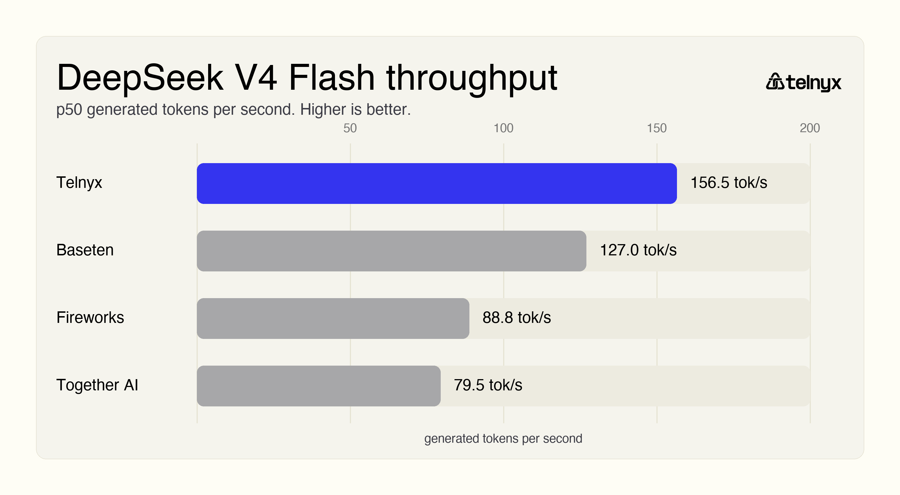
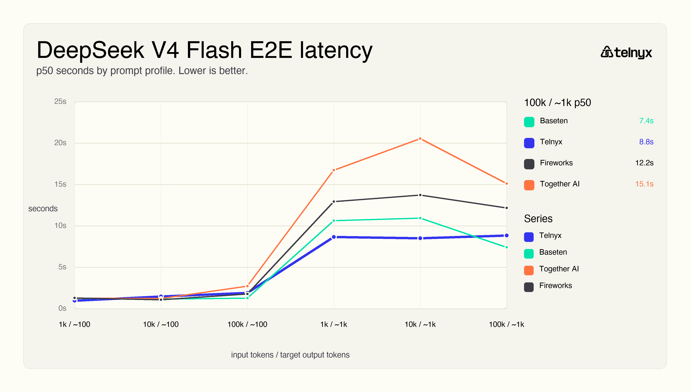
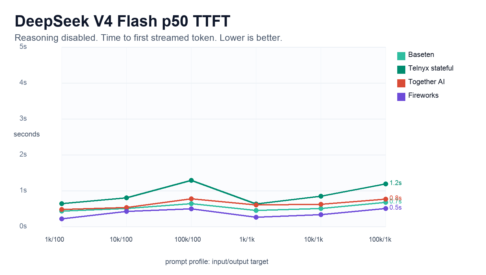

# DeepSeek V4 Flash inference on Telnyx stateful actors

When developers evaluate an inference provider, model availability is only the first question. The more practical question is how the model behaves under real application-shaped workloads: how quickly it starts streaming, how long the full answer takes, and how steady it looks as prompts and outputs get larger.

To test that, we ran a repeatable benchmark for `deepseek-ai/DeepSeek-V4-Flash-0731` using [Telnyx stateful actors](https://developers.telnyx.com/docs/edge-compute/stateful-actors) as the benchmark orchestrator. The actor owned the run, called each provider endpoint, streamed model responses, recorded timing metadata, and exported the results.

The value of this pattern is durability. A stateful actor can keep benchmark state and progress even when the client that started the job is no longer actively connected. The same pattern applies to eval jobs, batch enrichment, document processing, voice-agent analysis, and other long-running AI workflows.

## What we measured

We focused on three metrics developers feel directly in production apps:

- **E2E latency:** request start to final streamed token. Lower is better.
- **TTFT:** request start to first non-empty streamed model activity. Lower is better. In this reasoning-disabled run, successful rows did not contain reasoning text.
- **Throughput:** generated tokens per second after streaming begins. Higher is better.

E2E latency matters when the app needs the complete answer before taking the next step. TTFT matters when the app streams output and needs to feel responsive quickly. Throughput matters once the model is already responding and the user is waiting for the rest of the answer.

## Benchmark setup

The benchmark used six prompt profiles:

- 1k input / ~100 output
- 10k input / ~100 output
- 100k input / ~100 output
- 1k input / ~1k output
- 10k input / ~1k output
- 100k input / ~1k output

Each provider/model/profile combination ran 10 times with streaming enabled and temperature set to 0. This rerun also explicitly disabled reasoning where provider APIs accepted a reasoning-control field, and all successful rows emitted `0` reasoning characters.

| Provider | Model used | Clean rows | Failed rows |
|---|---|---:|---:|
| Telnyx stateful | `deepseek-ai/DeepSeek-V4-Flash-0731` | 60 | 0 |
| Baseten | `deepseek-ai/DeepSeek-V4-Flash-0731` | 54 | 6 |
| Together AI | `deepseek-ai/DeepSeek-V4-Flash-0731` | 60 | 0 |
| Fireworks | `accounts/fireworks/models/deepseek-v4-flash-0731` | 60 | 0 |

Baseten returned six `429 Rate limit exceeded` responses on long-context rows. Those failed rows were excluded from latency percentiles.

## Throughput

For generated-token throughput, higher is better. Telnyx stateful had the strongest p50 throughput in this rerun.

| Provider | p50 throughput |
|---|---:|
| Telnyx stateful | 156.5 tok/s |
| Baseten | 127.0 tok/s |
| Fireworks | 88.8 tok/s |
| Together AI | 79.5 tok/s |

That distinction matters for longer completions. TTFT controls when the user sees the first response; throughput controls how quickly the rest of the response arrives.

## Reliability and tail latency

Telnyx stateful completed all 60 rows. Baseten had the fastest p50 E2E, but six Baseten rows returned `429 Rate limit exceeded` on long-context profiles and were excluded from latency percentiles.

Among providers with 60/60 successful rows, Telnyx stateful had the lowest p95 E2E at 12.24s. Fireworks was close at 14.49s, while Together AI had a longer tail at 24.91s.

## E2E latency

Across clean rows, Baseten had the fastest p50 E2E latency in this rerun. Telnyx stateful was second on p50 E2E, but had the lowest p95 E2E among providers that completed all 60 rows.

| Provider | p50 E2E | p95 E2E | Max E2E |
|---|---:|---:|---:|
| Baseten | 4.01s | 12.97s | 17.81s |
| Telnyx stateful | 6.64s | 12.24s | 15.12s |
| Together AI | 7.90s | 24.91s | 56.21s |
| Fireworks | 8.31s | 14.49s | 15.36s |

The profile chart is the better read than a single overall number. Short-output requests stay closer together, while ~1k-output requests separate providers more clearly. That is expected because output length usually dominates E2E latency.

## TTFT

TTFT measures how quickly the first non-empty streamed model activity arrives. In this reasoning-disabled run, successful rows did not contain reasoning text, so the first activity is a closer proxy for visible response start than it would be in a reasoning-enabled run.

| Provider | p50 TTFT | p95 TTFT |
|---|---:|---:|
| Fireworks | 0.39s | 3.17s |
| Baseten | 0.56s | 2.85s |
| Together AI | 0.64s | 1.67s |
| Telnyx stateful | 0.88s | 5.78s |

## Why stateful actors fit this workflow

A benchmark is a useful example of a broader production pattern. Many AI workflows are not just one request and one response. They need to start a job, track progress, retry individual steps, store structured results, and export the final output.

[Telnyx stateful actors](https://developers.telnyx.com/docs/edge-compute/stateful-actors) fit that shape. In this benchmark, the actor:

- owned the run state,
- tracked completion across hundreds of model calls,
- streamed responses so TTFT and E2E could be measured separately,
- stored success and failure rows separately,
- exported clean CSV and report artifacts.

If you are building with [Telnyx inference](https://developers.telnyx.com/docs/inference/getting-started), this means inference can sit next to durable application logic. You can call an OpenAI-compatible inference endpoint, stream the response, measure user-facing latency, and keep workflow state inside the Telnyx edge compute layer.

Start here:

- [Telnyx inference getting started](https://developers.telnyx.com/docs/inference/getting-started)
- [Telnyx inference models](https://developers.telnyx.com/docs/inference/models)
- [Telnyx stateful actors](https://developers.telnyx.com/docs/edge-compute/stateful-actors)

## Methodology notes

Benchmark traffic was initiated from a Telnyx stateful actor using the regional `us-east-2` invoke URL. The benchmark called `https://api.telnyx.com/v2/ai` for Telnyx inference and each competitor through its own API path. We did not independently log the GPU-serving region for the Telnyx inference calls, so the results should not be described as proving same-region or zero-hop routing between the actor and model-serving layer.

This rerun controlled reasoning output by disabling reasoning behavior where provider APIs accepted that control. All successful rows emitted `0` reasoning characters. DSpark/speculative-decoding state was not independently toggled in this run, so throughput should be described as the observed result for Telnyx's current serving configuration, not as an architecture-only measurement.
