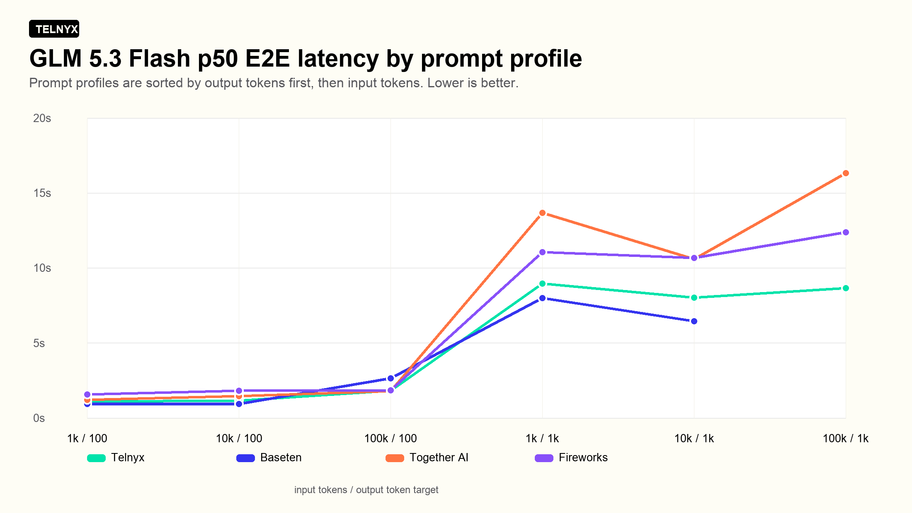
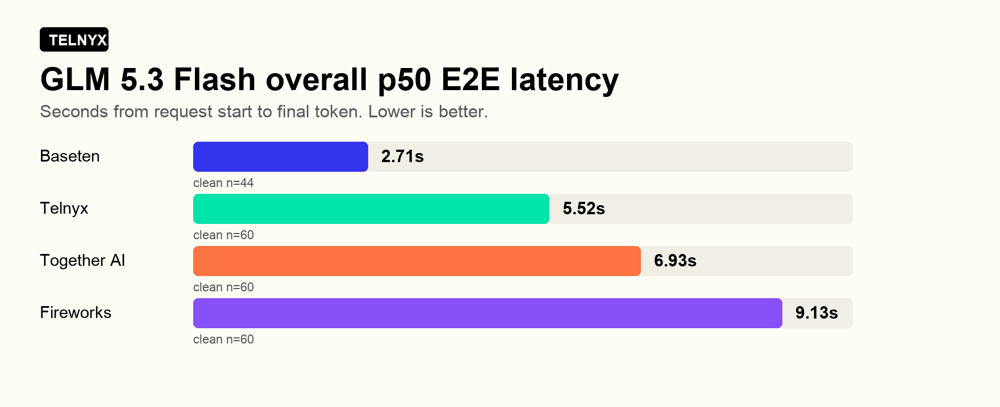
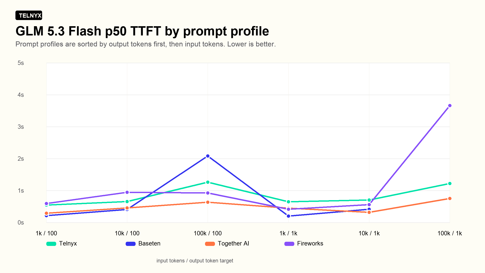
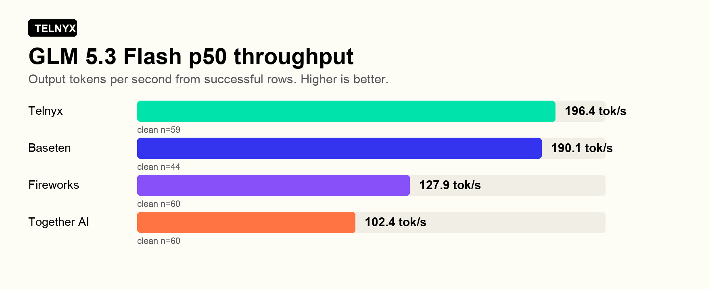

# LLM Inference Benchmarks: GLM 5.3 Flash

This benchmark compares GLM 5.3 Flash across Telnyx, Baseten, Together AI, and Fireworks using the same prompt profiles and streaming timing method from the recent stateful actor benchmark runs.

Telnyx traffic was initiated from [stateful actors](https://developers.telnyx.com/docs/edge-compute/stateful-actors) using the regional `us-east-2` invoke URL. Competitor calls were issued from that same benchmark actor to each provider API. The benchmark used exact model overlap where available: Telnyx, Baseten, and Together AI used `zai-org/GLM-5.3-Flash`; Fireworks used `accounts/fireworks/models/glm-5p3-flash`.

## E2E latency

End-to-end latency is the total time from request start until the final streamed token arrives. Lower is better.

| Provider | Model | Clean n | Failed | p50 E2E | p95 E2E | p50 TTFT | p95 TTFT | p50 throughput |
| --- | --- | --- | --- | --- | --- | --- | --- | --- |
| Baseten | `zai-org/GLM-5.3-Flash` | 44 | 16 | 2.71s | 10.21s | 0.37s | 1.08s | 190.1 tok/s |
| Telnyx | `zai-org/GLM-5.3-Flash` | 60 | 0* | 5.52s | 10.77s | 0.74s | 3.00s | 196.4 tok/s* |
| Together AI | `zai-org/GLM-5.3-Flash` | 60 | 0 | 6.93s | 19.91s | 0.46s | 3.89s | 102.4 tok/s |
| Fireworks | `accounts/fireworks/models/glm-5p3-flash` | 60 | 0 | 9.13s | 16.96s | 0.89s | 6.27s | 127.9 tok/s |

`*` Telnyx highlight: full Telnyx completion with no failed rows, and the best p50 throughput in this run.

For E2E, the best p50 provider in this run was **Baseten** at 2.71s. Telnyx p50 E2E was 5.52s across 60 clean rows.

| Profile | Telnyx | Baseten | Together AI | Fireworks |
| --- | --- | --- | --- | --- |
| 1k / 100 | 1.10s | 0.93s | 1.19s | 1.55s |
| 10k / 100 | 1.15s | 0.92s | 1.44s | 1.81s |
| 100k / 100 | 1.81s | 2.63s | 1.78s | 1.83s |
| 1k / 1k | 8.96s | 8.00s | 13.68s | 11.05s |
| 10k / 1k | 8.02s | 6.43s | 10.57s | 10.66s |
| 100k / 1k | 8.66s | n/a | 16.33s | 12.37s |

## TTFT

TTFT measures how quickly the first non-empty streamed model activity arrives. That activity may be reasoning rather than visible answer text, so it should not be interpreted as time to first visible answer. Lower is better.

The best p50 TTFT provider in this run was **Baseten** at 0.37s. Telnyx p50 TTFT was 0.74s.

| Profile | Telnyx | Baseten | Together AI | Fireworks |
| --- | --- | --- | --- | --- |
| 1k / 100 | 0.54s | 0.21s | 0.29s | 0.59s |
| 10k / 100 | 0.65s | 0.41s | 0.45s | 0.94s |
| 100k / 100 | 1.26s | 2.08s | 0.63s | 0.92s |
| 1k / 1k | 0.64s | 0.20s | 0.45s | 0.41s |
| 10k / 1k | 0.70s | 0.41s | 0.32s | 0.56s |
| 100k / 1k | 1.21s | n/a | 0.75s | 3.66s |

## Throughput

Throughput is output tokens per second after generation starts. Higher is better.

The best p50 throughput provider in this run was **Telnyx** at 196.4 tok/s. Telnyx p50 throughput was 196.4 tok/s.

## Methodology

- Run ID: `glm53-flash-stateful-provider-benchmark-20260902-001`
- Run started: 2026-09-02 10:08 AM PT
- Total attempted rows: 240
- Successful rows used in percentile calculations: 224
- Failed rows excluded from latency and throughput percentiles: 16
- Prompt profiles: `1k/100`, `1k/1k`, `10k/100`, `10k/1k`, `100k/100`, `100k/1k`
- Repeats: 10 per provider/profile
- Streaming timing captured E2E, TTFT, content TTFT, chunk counts, output characters, token usage, and effective tokens/sec.
- Benchmark execution used the regional `us-east-2` actor route because the global actor route was unreliable for this org during earlier testing.
- These results test stateful-actor-based execution from the working regional cluster path; they do not test global GSLB/failover behavior.
- Token usage probing was enabled so throughput could still be calculated if streamed usage was unavailable.

## Caveats

- Baseten: 6 row(s) failed on 100k / 100 with HTTP 429.
- Baseten: 10 row(s) failed on 100k / 1k with HTTP 429.
- Baseten 429 rows were excluded from the percentile tables and charts.
- Telnyx throughput was calculated from non-stream token-usage probes for 59 of 60 successful Telnyx rows; one successful Telnyx row did not return usable token usage from the probe. E2E and TTFT were unaffected.
- The actor location and public invoke URL are known, but the final GPU-serving region for each inference provider was not independently logged.
- Results are a point-in-time benchmark, not an SLA.

## Model References

- Telnyx GLM 5.3 Flash release note: https://telnyx.com/release-notes/glm-5-3-flash-inference
- Baseten GLM 5.3 Flash library page: https://www.baseten.co/library/glm-53-flash/
- Together AI GLM 5.3 Flash page: https://www.together.ai/models/glm-5-3-flash
- Fireworks GLM 5.3 Flash page: https://fireworks.ai/models/fireworks/glm-5p3-flash
