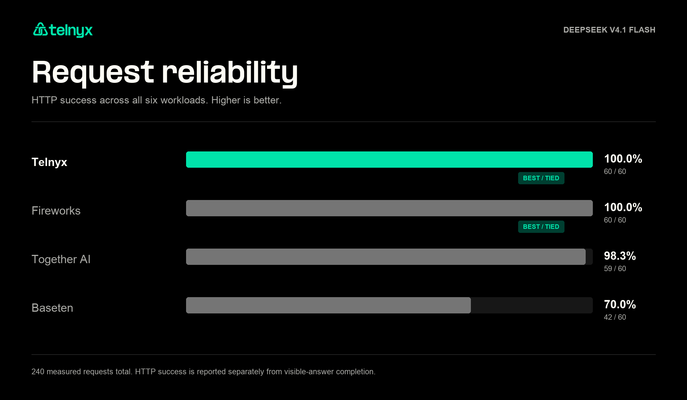
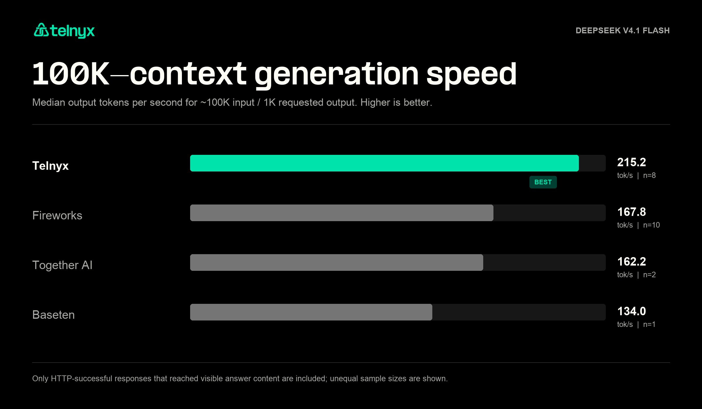
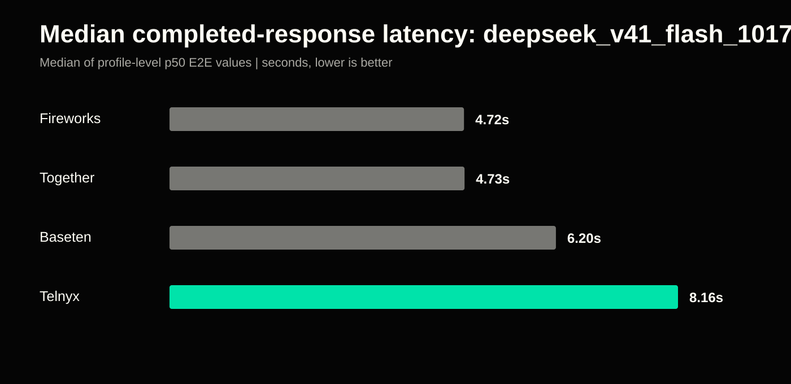
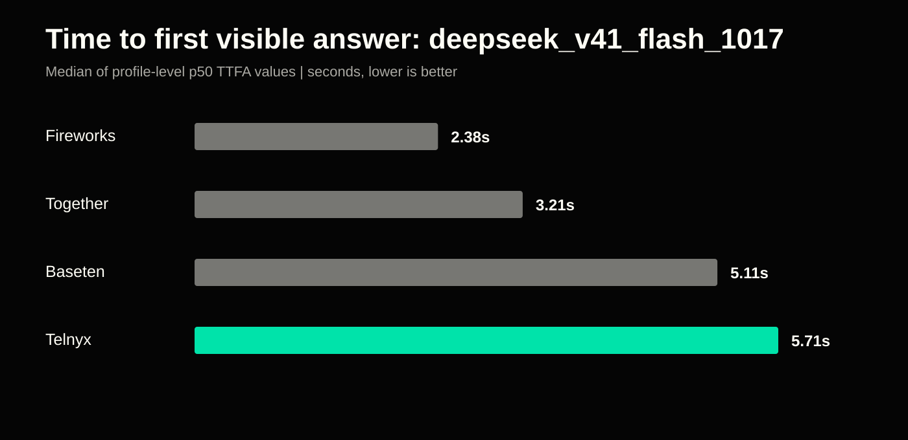
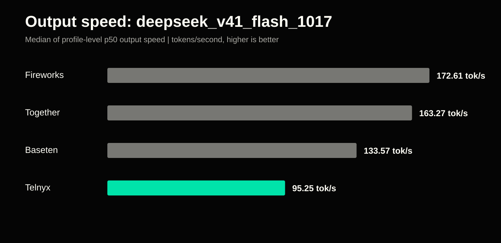
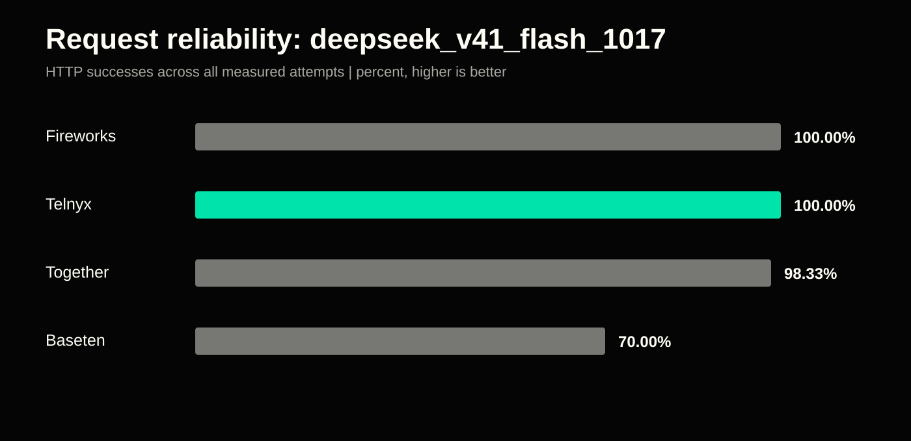

# Weekly inference benchmark: DeepSeek V4.1 Flash 1017

- Scheduled date: `2026-11-23`
- Request origin: Telnyx Stateful Actor
- Featured task: Moby-Dick serving and long-context performance
- Raw reasoning and answer text are retained only in the private workflow artifact. Public datasets contain timing, token, status, and error fields only.
- p95 values are observed sample percentiles, not service-level objectives.

## Results by provider and profile

| Suite | Provider | Profile | HTTP success | Visible answers | p50 TTFT | p50 TTFA | p50 E2E | p50 output speed |
|---|---|---|---:|---:|---:|---:|---:|---:|
| deepseek_v41_flash_1017 | baseten | 01_1k_in_100_out | 10/10 | 10/10 | 0.44s | 1.46s | 1.48s | 122.11 tok/s |
| deepseek_v41_flash_1017 | baseten | 02_1k_in_1k_out | 10/10 | 10/10 | 0.38s | 7.13s | 9.23s | 142.06 tok/s |
| deepseek_v41_flash_1017 | baseten | 03_10k_in_100_out | 10/10 | 10/10 | 0.54s | 1.29s | 1.48s | 133.09 tok/s |
| deepseek_v41_flash_1017 | baseten | 04_10k_in_1k_out | 10/10 | 10/10 | 0.64s | 7.54s | 10.10s | 127.87 tok/s |
| deepseek_v41_flash_1017 | baseten | 05_100k_in_100_out | 1/10 | 1/10 | 2.44s | 3.09s | 3.16s | 167.44 tok/s |
| deepseek_v41_flash_1017 | baseten | 06_100k_in_1k_out | 1/10 | 1/10 | 1.74s | 7.95s | 10.69s | 134.04 tok/s |
| deepseek_v41_flash_1017 | fireworks | 01_1k_in_100_out | 10/10 | 9/10 | 0.61s | 1.23s | 1.27s | 177.40 tok/s |
| deepseek_v41_flash_1017 | fireworks | 02_1k_in_1k_out | 10/10 | 3/10 | 0.76s | 3.50s | 8.04s | 163.34 tok/s |
| deepseek_v41_flash_1017 | fireworks | 03_10k_in_100_out | 10/10 | 10/10 | 0.77s | 1.26s | 1.40s | 190.96 tok/s |
| deepseek_v41_flash_1017 | fireworks | 04_10k_in_1k_out | 10/10 | 0/10 | 0.98s | n/a | n/a | n/a |
| deepseek_v41_flash_1017 | fireworks | 05_100k_in_100_out | 10/10 | 0/10 | 2.38s | n/a | n/a | n/a |
| deepseek_v41_flash_1017 | fireworks | 06_100k_in_1k_out | 10/10 | 10/10 | 1.97s | 4.35s | 9.02s | 167.82 tok/s |
| deepseek_v41_flash_1017 | telnyx | 01_1k_in_100_out | 10/10 | 4/10 | 2.13s | 3.65s | 3.98s | 62.29 tok/s |
| deepseek_v41_flash_1017 | telnyx | 02_1k_in_1k_out | 10/10 | 5/10 | 2.93s | 7.76s | 17.52s | 85.92 tok/s |
| deepseek_v41_flash_1017 | telnyx | 03_10k_in_100_out | 10/10 | 9/10 | 1.78s | 2.65s | 3.05s | 104.59 tok/s |
| deepseek_v41_flash_1017 | telnyx | 04_10k_in_1k_out | 10/10 | 0/10 | 3.59s | n/a | n/a | n/a |
| deepseek_v41_flash_1017 | telnyx | 05_100k_in_100_out | 10/10 | 0/10 | 11.00s | n/a | n/a | n/a |
| deepseek_v41_flash_1017 | telnyx | 06_100k_in_1k_out | 10/10 | 8/10 | 5.00s | 8.02s | 12.33s | 215.19 tok/s |
| deepseek_v41_flash_1017 | together | 01_1k_in_100_out | 10/10 | 6/10 | 0.31s | 0.94s | 1.03s | 164.37 tok/s |
| deepseek_v41_flash_1017 | together | 02_1k_in_1k_out | 10/10 | 3/10 | 0.48s | 6.25s | 7.93s | 162.11 tok/s |
| deepseek_v41_flash_1017 | together | 03_10k_in_100_out | 10/10 | 9/10 | 0.64s | 1.41s | 1.53s | 196.41 tok/s |
| deepseek_v41_flash_1017 | together | 04_10k_in_1k_out | 10/10 | 0/10 | 0.49s | n/a | n/a | n/a |
| deepseek_v41_flash_1017 | together | 05_100k_in_100_out | 10/10 | 0/10 | 2.00s | n/a | n/a | n/a |
| deepseek_v41_flash_1017 | together | 06_100k_in_1k_out | 9/10 | 2/10 | 1.49s | 5.00s | 8.82s | 162.17 tok/s |

## Failures and limitations

No explicit reasoning effort was requested, so each endpoint used its provider default. The completion-token allowance includes reasoning tokens; requests that exhausted the allowance before visible content are counted as HTTP successes without a visible answer. Compare TTFA, E2E, and output-speed cells only with their reported visible-answer sample counts.

Failures remain in the request-level dataset and are excluded from latency percentiles. A rate-limit response can reflect an account quota, so it is not presented as model-serving latency.

| Suite | Provider | HTTP status | Count | Reported error |
|---|---|---:|---:|---|
| deepseek_v41_flash_1017 | baseten | 429 | 18 | {"error":{"message":"Rate limit exceeded","type":"rate_limit_error","param":null,"code":"rate_limit_exceeded"}} |
| deepseek_v41_flash_1017 | together | 402 | 1 | {"id":"4fed696af9b14c018b6ce519427002f5-aws_ue1","error":{"message":"Credit limit exceeded, please [add credits](https://api.together.ai/settings/billing). If you've already made a payment, please wait up to 5 minutes for balances to update |

## Charts

### HTTP reliability across all profiles

### 100K-context generation speed

The generation-speed chart includes only HTTP-successful responses that reached visible answer content. The unequal sample sizes are printed on the chart and should be considered when comparing medians.

### Median completed-response latency

### Time to first visible answer

### Output speed

### Request reliability

## Methodology

The workflow first sends an exact-model smoke request to each configured provider. Telnyx and at least one competitor must return a visible answer; providers that fail qualification are excluded and disclosed before warm-up or measured traffic begins. The workflow then sends five warm-ups and ten measured requests per 1K, 10K, and 100K input profile with short and long requested outputs. Failures remain in the dataset and are excluded only from latency percentiles.

No weighted overall winner is calculated, and no developer blog is published automatically.
