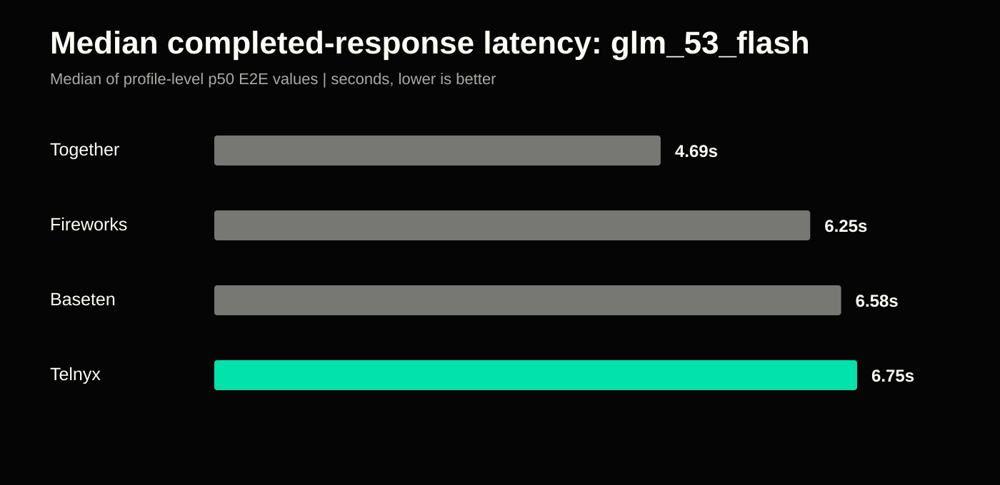
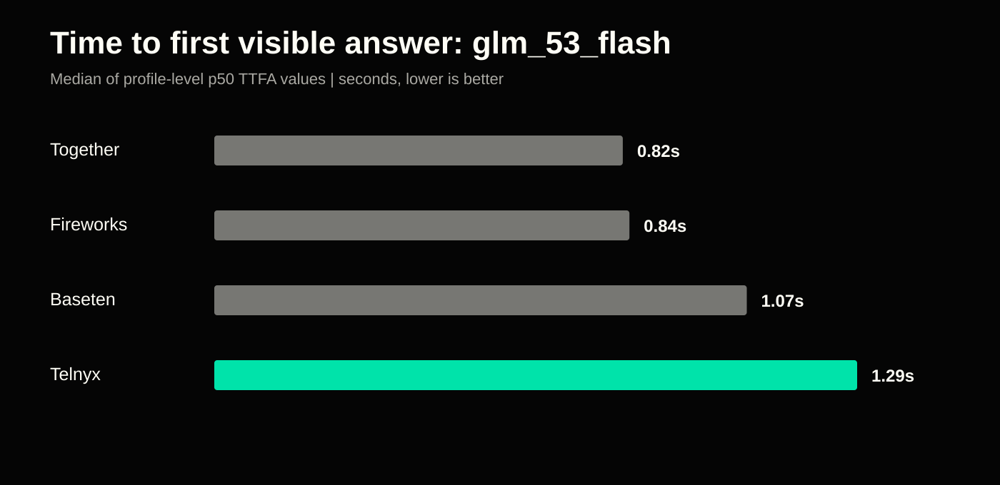
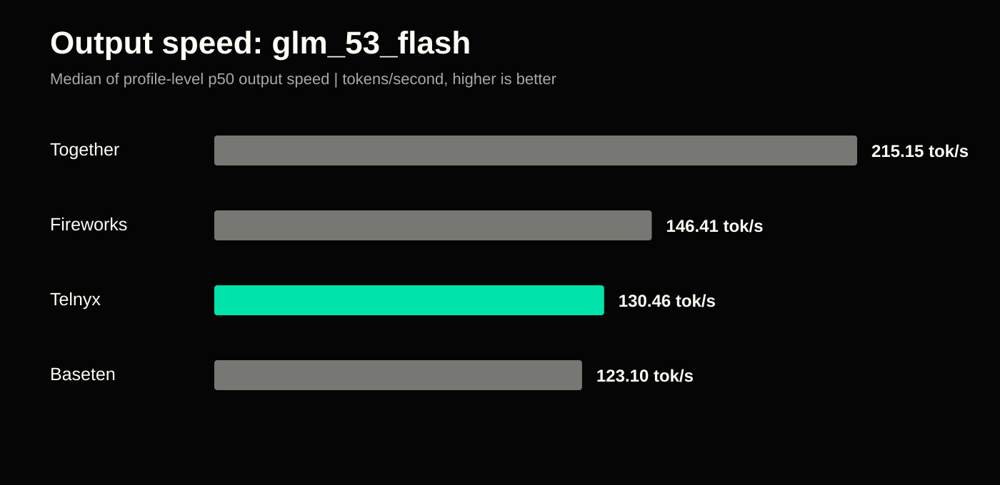
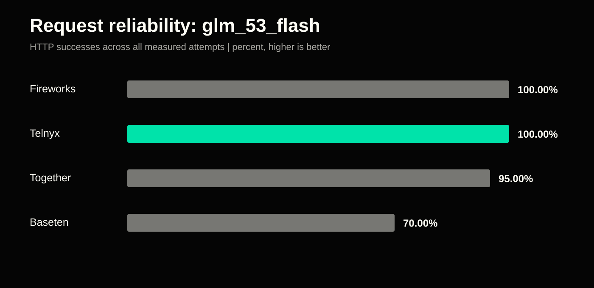

# Weekly inference benchmark: GLM 5.3 Flash

- Scheduled date: `2026-11-23`
- Request origin: Telnyx Stateful Actor
- Featured task: Moby-Dick serving and long-context performance
- Raw reasoning and answer text are retained only in the private workflow artifact. Public datasets contain timing, token, status, and error fields only.
- p95 values are observed sample percentiles, not service-level objectives.

## Results by provider and profile

| Suite | Provider | Profile | HTTP success | Visible answers | p50 TTFT | p50 TTFA | p50 E2E | p50 output speed |
|---|---|---|---:|---:|---:|---:|---:|---:|
| glm_53_flash | baseten | 01_1k_in_100_out | 10/10 | 10/10 | 0.42s | 0.42s | 1.48s | 116.12 tok/s |
| glm_53_flash | baseten | 02_1k_in_1k_out | 10/10 | 10/10 | 0.14s | 0.50s | 10.85s | 112.01 tok/s |
| glm_53_flash | baseten | 03_10k_in_100_out | 10/10 | 10/10 | 0.54s | 0.54s | 1.30s | 115.45 tok/s |
| glm_53_flash | baseten | 04_10k_in_1k_out | 10/10 | 10/10 | 0.34s | 1.60s | 9.80s | 130.08 tok/s |
| glm_53_flash | baseten | 05_100k_in_100_out | 1/10 | 1/10 | 2.55s | 2.55s | 3.36s | 148.37 tok/s |
| glm_53_flash | baseten | 06_100k_in_1k_out | 1/10 | 1/10 | 2.23s | 2.54s | 9.97s | 155.14 tok/s |
| glm_53_flash | fireworks | 01_1k_in_100_out | 10/10 | 10/10 | 0.37s | 0.37s | 1.17s | 139.79 tok/s |
| glm_53_flash | fireworks | 02_1k_in_1k_out | 10/10 | 10/10 | 0.36s | 0.36s | 9.03s | 138.59 tok/s |
| glm_53_flash | fireworks | 03_10k_in_100_out | 10/10 | 10/10 | 0.62s | 0.62s | 1.18s | 155.98 tok/s |
| glm_53_flash | fireworks | 04_10k_in_1k_out | 10/10 | 10/10 | 0.60s | 1.06s | 8.69s | 147.49 tok/s |
| glm_53_flash | fireworks | 05_100k_in_100_out | 10/10 | 10/10 | 3.01s | 3.01s | 3.82s | 152.15 tok/s |
| glm_53_flash | fireworks | 06_100k_in_1k_out | 10/10 | 10/10 | 3.10s | 3.10s | 11.04s | 145.33 tok/s |
| glm_53_flash | telnyx | 01_1k_in_100_out | 10/10 | 10/10 | 0.52s | 0.52s | 1.38s | 119.23 tok/s |
| glm_53_flash | telnyx | 02_1k_in_1k_out | 10/10 | 10/10 | 0.48s | 0.53s | 9.68s | 129.88 tok/s |
| glm_53_flash | telnyx | 03_10k_in_100_out | 10/10 | 10/10 | 0.82s | 0.82s | 1.40s | 127.51 tok/s |
| glm_53_flash | telnyx | 04_10k_in_1k_out | 10/10 | 10/10 | 0.76s | 1.76s | 9.80s | 133.52 tok/s |
| glm_53_flash | telnyx | 05_100k_in_100_out | 10/10 | 10/10 | 2.51s | 2.51s | 3.81s | 131.05 tok/s |
| glm_53_flash | telnyx | 06_100k_in_1k_out | 10/10 | 10/10 | 2.27s | 2.27s | 10.06s | 156.75 tok/s |
| glm_53_flash | together | 01_1k_in_100_out | 10/10 | 10/10 | 0.26s | 0.26s | 0.79s | 217.22 tok/s |
| glm_53_flash | together | 02_1k_in_1k_out | 9/10 | 9/10 | 0.24s | 0.30s | 6.08s | 202.88 tok/s |
| glm_53_flash | together | 03_10k_in_100_out | 9/10 | 9/10 | 0.45s | 0.45s | 0.86s | 233.45 tok/s |
| glm_53_flash | together | 04_10k_in_1k_out | 9/10 | 9/10 | 0.61s | 1.19s | 6.70s | 200.25 tok/s |
| glm_53_flash | together | 05_100k_in_100_out | 10/10 | 10/10 | 2.70s | 2.70s | 3.29s | 213.07 tok/s |
| glm_53_flash | together | 06_100k_in_1k_out | 10/10 | 10/10 | 2.73s | 2.87s | 8.13s | 224.27 tok/s |

## Failures and limitations

Failures remain in the request-level dataset and are excluded from latency percentiles. A rate-limit response can reflect an account quota, so it is not presented as model-serving latency.

| Suite | Provider | HTTP status | Count | Reported error |
|---|---|---:|---:|---|
| glm_53_flash | baseten | 429 | 18 | {"error":{"message":"Rate limit exceeded","type":"rate_limit_error","param":null,"code":"rate_limit_exceeded"}} |
| glm_53_flash | together | 503 | 3 | {"error":{"type":"server_error","code":"start_generation_failed","message":"The backend failed to process the request","param":null}} |

## Charts

### Median completed-response latency

### Time to first visible answer

### Output speed

### Request reliability

## Methodology

Each suite must pass an exact-model smoke request for every configured provider before warm-up or measured traffic begins. The workflow then sends five warm-ups and ten measured requests per 1K, 10K, and 100K input profile with short and long requested outputs. Failures remain in the dataset and are excluded only from latency percentiles.

No weighted overall winner is calculated, and no developer blog is published automatically.
