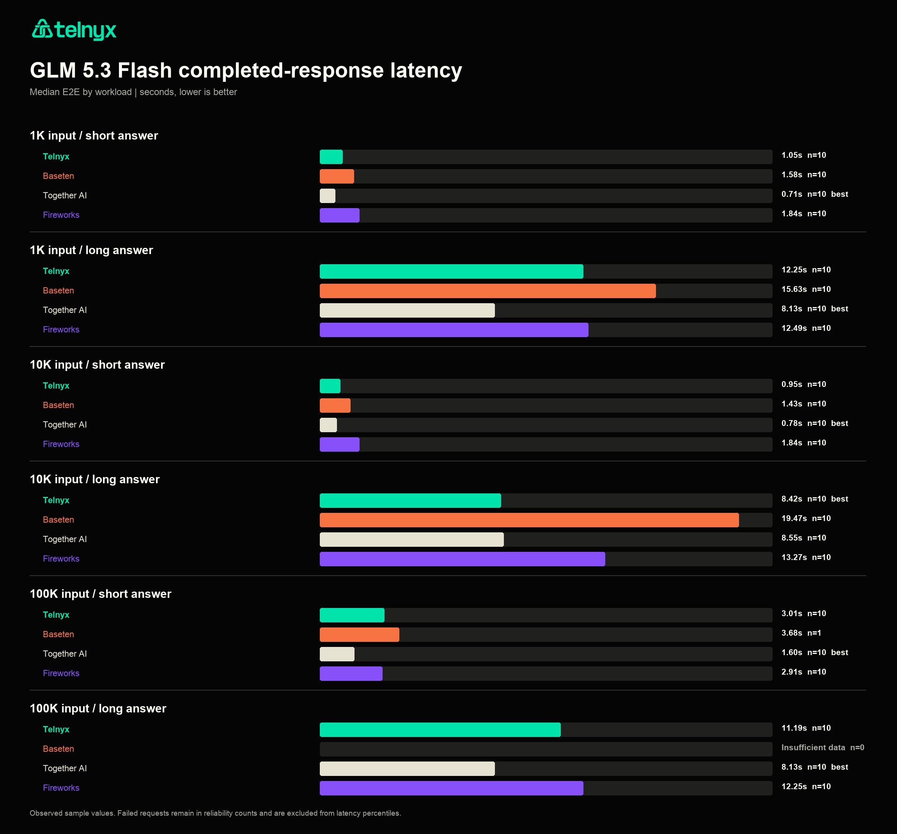
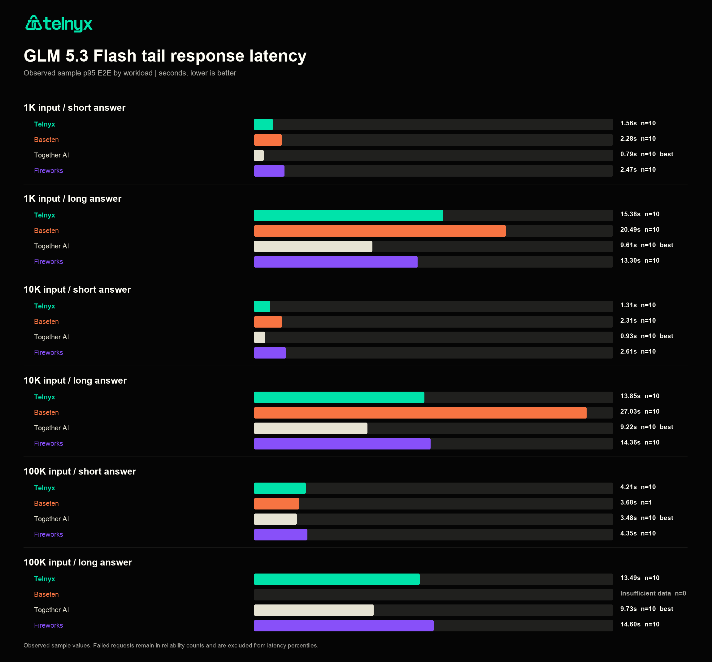
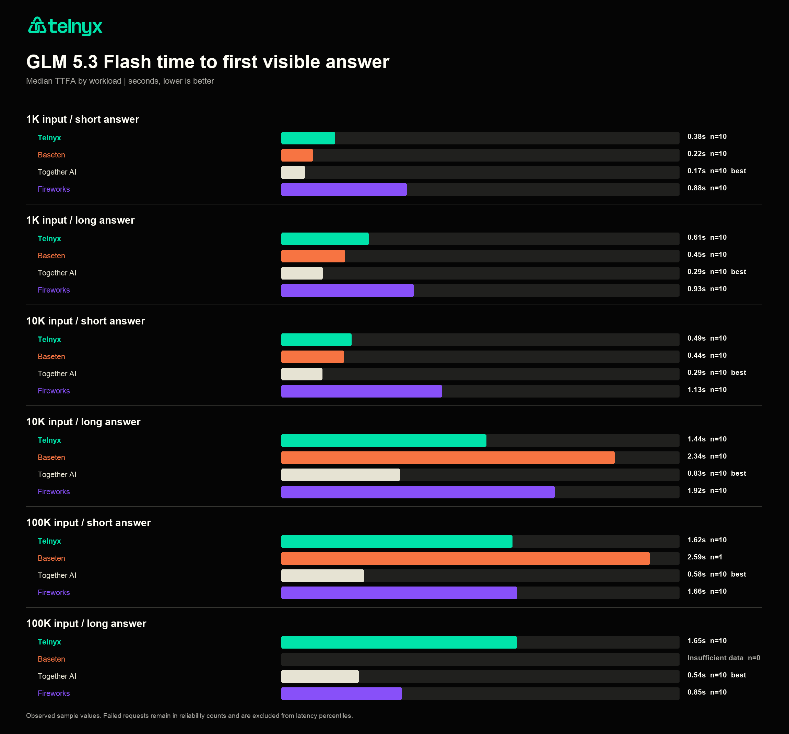
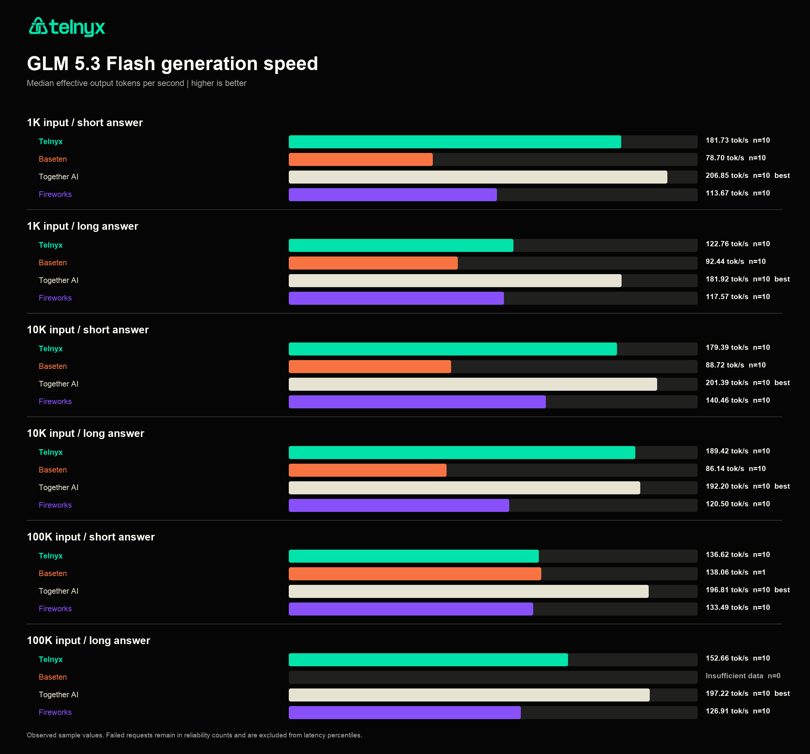
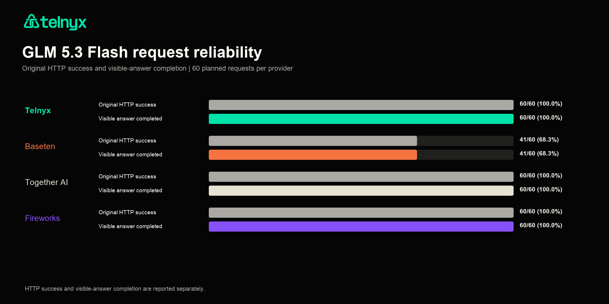
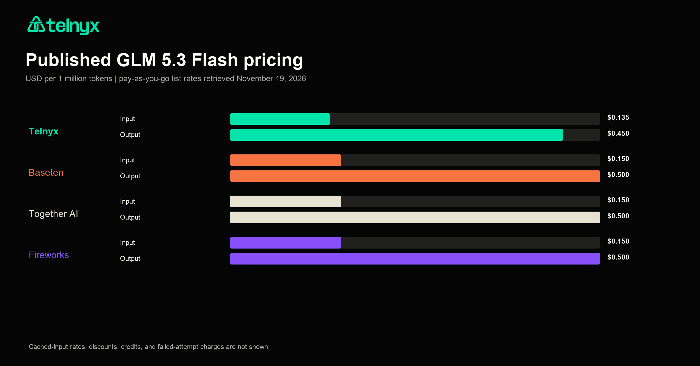

# GLM 5.3 Flash long-context analysis benchmark across four inference providers

Choosing an open-weight model does not finish the infrastructure decision. Two APIs can expose the same checkpoint and still give an application different response times, failure rates, generation speeds, and token costs. Those differences become especially important for coding agents, document pipelines, and other workflows that cannot take their next action until a response is complete.

We compared [`zai-org/GLM-5.3-Flash`](https://developers.telnyx.com/docs/inference/models) on [Telnyx Inference](https://telnyx.com/products/inference), Baseten, Together AI, and Fireworks. Every provider received the same six public-domain text workloads, sampling settings, reasoning effort, completion limits, and streaming behavior from one common request origin.

The result was not a single winner across every metric. Together AI started and generated answers faster in most workload cells. Telnyx completed all 60 planned requests, recorded the lowest estimated token cost among the providers with complete samples, and remained close to Together on pooled median completed-response latency. Baseten returned HTTP 429 responses for 19 of its 20 long-context requests, so we kept those failures in the reliability result and withheld its incomplete pooled latency and cost figures.

That separation is the point of this benchmark: **responsiveness, completion speed, reliability, and cost answer different production questions.**

## GLM 5.3 Flash benchmark results

| Provider | Visible answers | p50 first visible answer | p50 completed response | Observed p95 completed response | p50 output speed | Estimated token cost |
|---|---:|---:|---:|---:|---:|---:|
| Telnyx | **60/60** | 0.93s | 5.73s | 13.56s | 156.7 tok/s | **$0.289** |
| Baseten | 41/60 | N/A* | N/A* | N/A* | N/A* | N/A* |
| Together AI | **60/60** | **0.44s** | **5.51s** | **9.23s** | **195.8 tok/s** | $0.322 |
| Fireworks | **60/60** | 1.15s | 7.76s | 13.54s | 123.5 tok/s | $0.321 |

`*` Baseten's pooled metrics are withheld because its two 100K-input cells were incomplete. Valid measurements and sample counts remain available in the [public benchmark dataset](https://github.com/team-telnyx/benchmark/tree/main/inference/2026-11-glm-5-3-flash-weekly-pilot).

The cost estimate applies captured input and output token counts to the published pay-as-you-go prices used for the comparison. It is not an invoice and excludes discounts, credits, caching, and failed requests without reported usage.

## Completed responses were competitive on Telnyx

End-to-end latency measures the full request, from sending the prompt until the streamed response finishes. It matters when an agent must parse the complete answer, a document workflow needs the final extraction, or an application cannot advance on partial output.

Together AI recorded the lowest pooled median completed-response latency at **5.51 seconds**. Telnyx followed at **5.73 seconds**, ahead of Fireworks at **7.76 seconds**. Telnyx also recorded the lowest median E2E time for the 10K-input, long-answer workload: **8.42 seconds**, compared with **8.55 seconds** on Together, **13.27 seconds** on Fireworks, and **19.47 seconds** on Baseten.



The workload-level result is more useful than declaring one universal speed ranking. Short answers emphasize prompt processing and startup time. Long answers place more weight on generation speed. Long-context requests add a much larger prefill workload before generation begins.

## Tail latency favored Together in this sample

Median latency describes a typical observation. Tail latency helps show what slower requests looked like in the measured sample. Together recorded the lowest observed p95 E2E value in all six complete workload comparisons.



These p95 values are interpolated sample percentiles from ten planned requests per provider and workload, not provider SLAs. One slow response can move a small-sample p95 substantially. They are useful for identifying behavior worth retesting, but they should not be read as a promise about future production traffic.

## First visible answer and final answer are different metrics

GLM 5.3 Flash can stream reasoning before it emits answer text. We therefore tracked two starting points:

- **Time to first token (TTFT):** the first non-empty model output, including reasoning.
- **Time to first visible answer (TTFA):** the first answer text an application could display.

Together had the lowest pooled median TTFA at **0.44 seconds**, followed by Telnyx at **0.93 seconds** and Fireworks at **1.15 seconds**. Baseten's pooled value is not reported because its long-context sample was incomplete.



For a chat interface, TTFA often shapes perceived responsiveness. For an agent that waits for a complete response before calling a tool, E2E latency may be the more relevant measure. Reporting only “time to first token” can hide the time spent streaming reasoning before useful answer content appears.

## Generation speed separated the providers

Once answer text began, Together had the highest pooled median output rate at **195.8 tokens per second**. Telnyx followed at **156.7 tokens per second**, and Fireworks recorded **123.5 tokens per second**.



Output rate becomes increasingly important as requested answers get longer. It helps explain why providers with similar first-answer timing can finish a generation-heavy request at different times.

## Reliability changed the usable comparison

Telnyx, Together, and Fireworks each produced visible answer content for all **60 of 60** planned requests. Baseten completed **41 of 60**. Its 19 failures were HTTP 429 responses in the two 100K-input workloads: nine failures in the short-answer cell and ten in the long-answer cell.



We did not replace those failures with successful retries or exclude them from the dataset. Failed requests remain part of the reliability result. Baseten's successful workload cells are still reported individually, but pooling an incomplete long-context sample with its completed short-context cells would make its overall latency look more representative than it is.

## Telnyx had the lowest published token rates in the comparison

The published pay-as-you-go rates captured for GLM 5.3 Flash were **$0.135 per million input tokens and $0.450 per million output tokens on Telnyx**. The other three providers were listed at **$0.150 input and $0.500 output per million tokens**.



Applied to successful requests with reported token usage, the estimated total was **$0.289 on Telnyx**, **$0.322 on Together**, and **$0.321 on Fireworks**. Baseten's incomplete sample is not given a pooled total. The estimates assume uncached input because the benchmark did not receive verified cached-token counts.

## How we benchmarked GLM 5.3 Flash

We created six prompt profiles from the public-domain text of *Moby-Dick*. The profiles combined approximately 1K, 10K, and 100K input contexts with short and long answer targets.

| Workload | Approximate input | Requested answer shape | Planned requests per provider |
|---|---:|---|---:|
| Short context, short answer | 1K tokens | Short | 10 |
| Short context, long answer | 1K tokens | Long | 10 |
| Medium context, short answer | 10K tokens | Short | 10 |
| Medium context, long answer | 10K tokens | Long | 10 |
| Long context, short answer | 100K tokens | Short | 10 |
| Long context, long answer | 100K tokens | Long | 10 |

All requests used temperature 0, streaming, and `reasoning_effort: low`. Short-answer profiles allowed up to 1,024 completion tokens; long-answer profiles allowed up to 4,096. The benchmark runner called every provider's public API from the same Telnyx Stateful Actor request origin. This controls the origin of the requests; it does not establish where any provider served inference.

Requests ran sequentially. Provider order was fixed rather than randomized, so changing provider load over time is a possible confounder. The public dataset preserves all 240 planned attempts, the 221 answer-complete rows used for latency calculations, and the 19 failures.

## What this benchmark does not claim

- It measures one model, one reasoning setting, and six workload shapes, not every application.
- It is a point-in-time observation, not a provider SLA.
- Matching model names do not prove identical quantization, batching, speculative decoding, or other provider-side configuration.
- The prompts measure serving behavior across controlled context and output sizes. They do not compare answer quality.
- The benchmark did not verify prompt-cache hits or estimate cached-input savings.
- Ten observations per workload cell are enough to expose differences worth investigating, but not to characterize every tail-latency condition.

## Measure the latency your application actually waits for

Telnyx's Inference API is OpenAI-compatible, so developers can measure first visible answer and completed-response time with the same streamed call:

```python
import os
import time
from openai import OpenAI

client = OpenAI(
    api_key=os.environ["TELNYX_API_KEY"],
    base_url="https://api.telnyx.com/v2/ai/openai",
)

started = time.perf_counter()
first_answer = None

stream = client.chat.completions.create(
    model="zai-org/GLM-5.3-Flash",
    messages=[{"role": "user", "content": "Summarize this document..."}],
    reasoning_effort="low",
    stream=True,
)

for chunk in stream:
    if not chunk.choices:
        continue
    content = chunk.choices[0].delta.content or ""
    if content.strip() and first_answer is None:
        first_answer = time.perf_counter() - started

completed = time.perf_counter() - started
print(f"First visible answer: {first_answer:.2f}s")
print(f"Completed response: {completed:.2f}s")
```

Use prompts and output lengths from your real workflow, retain failures, and measure the event the application actually waits for. In this comparison, Telnyx's clearest strengths were **complete request reliability, the lowest estimated token cost among complete providers, and competitive completed-response latency**. Together led most raw speed measures. Both findings matter when choosing an inference API.

[Start building with Telnyx Inference](https://telnyx.com/products/inference), or inspect the [public benchmark report, datasets, configuration, and charts](https://github.com/team-telnyx/benchmark/tree/main/inference/2026-11-glm-5-3-flash-weekly-pilot) before adapting the test to your workload.

## Resources

- [Telnyx Inference API quickstart](https://developers.telnyx.com/docs/inference/getting-started)
- [Telnyx model catalog](https://developers.telnyx.com/docs/inference/models)
- [Telnyx inference pricing](https://telnyx.com/pricing/inference-api)
- [Baseten pricing](https://www.baseten.co/pricing/)
- [Together AI GLM 5.3 Flash](https://www.together.ai/models/glm-5-3-flash)
- [Fireworks GLM 5.3 Flash](https://fireworks.ai/models/fireworks/glm-5p3-flash)
- [Public benchmark artifacts](https://github.com/team-telnyx/benchmark/tree/main/inference/2026-11-glm-5-3-flash-weekly-pilot)
