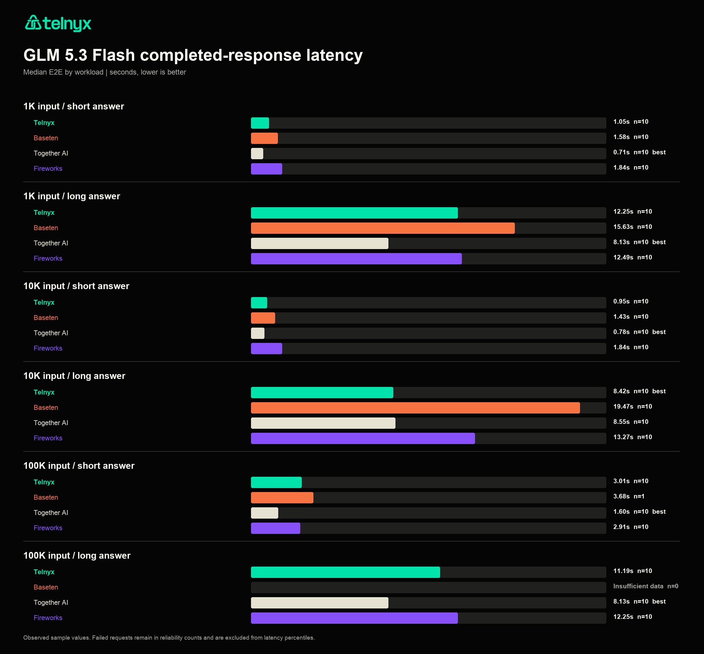
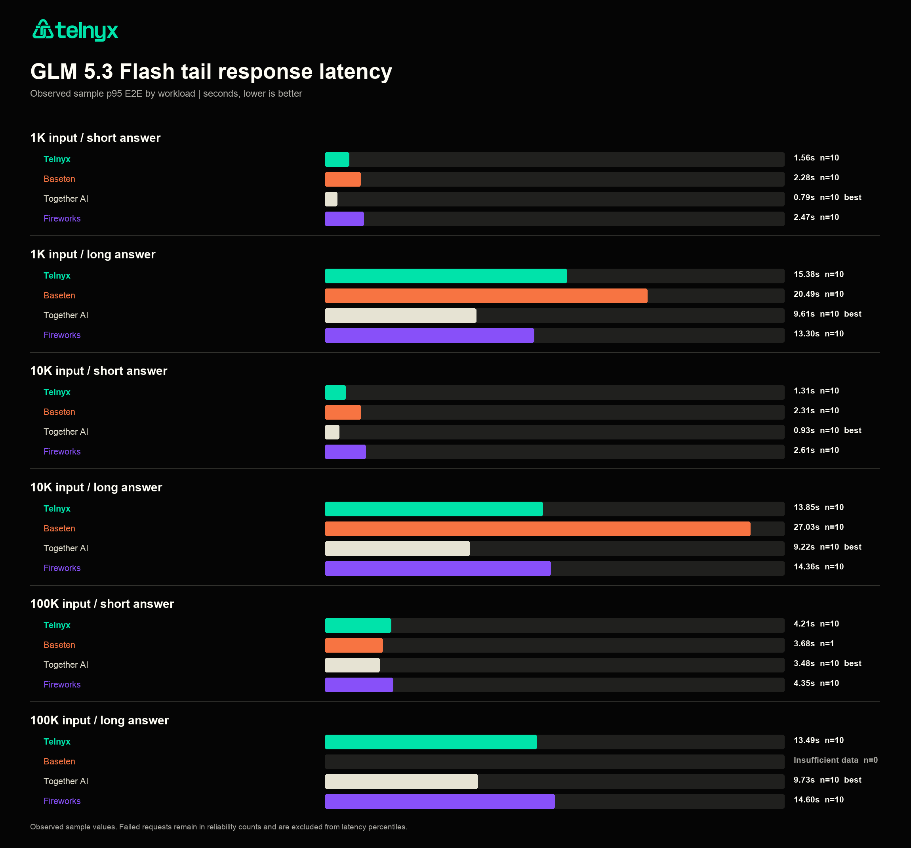
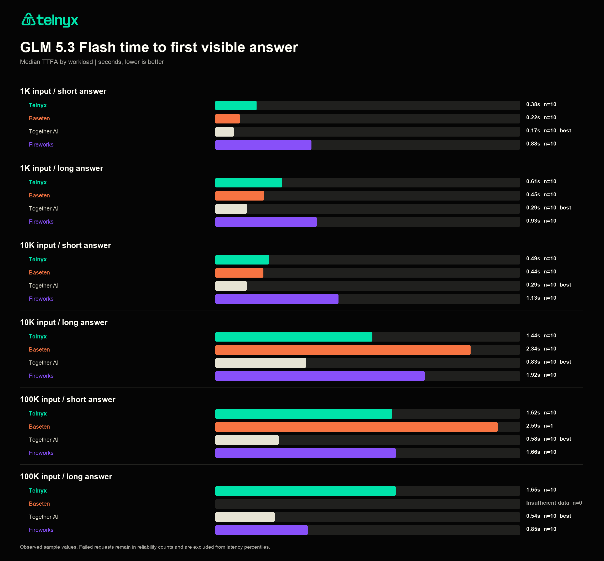
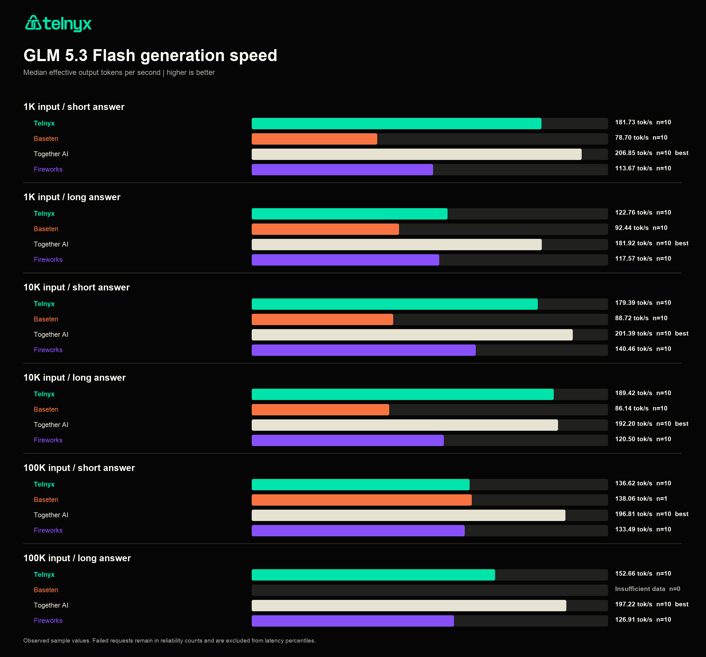
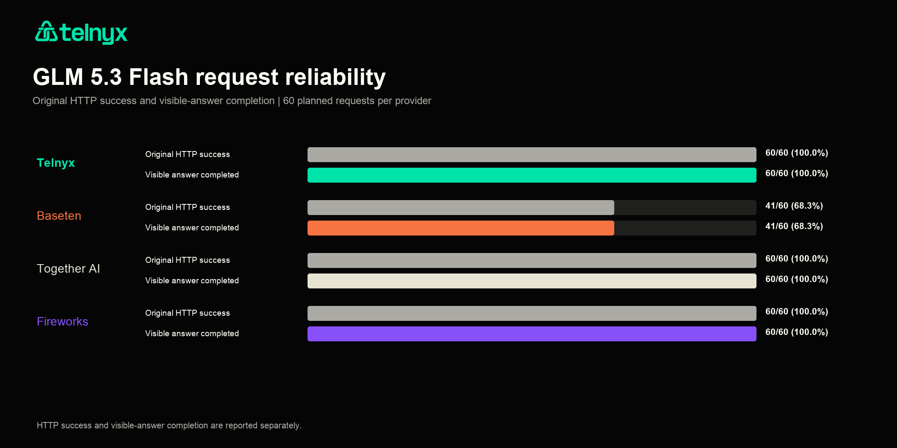
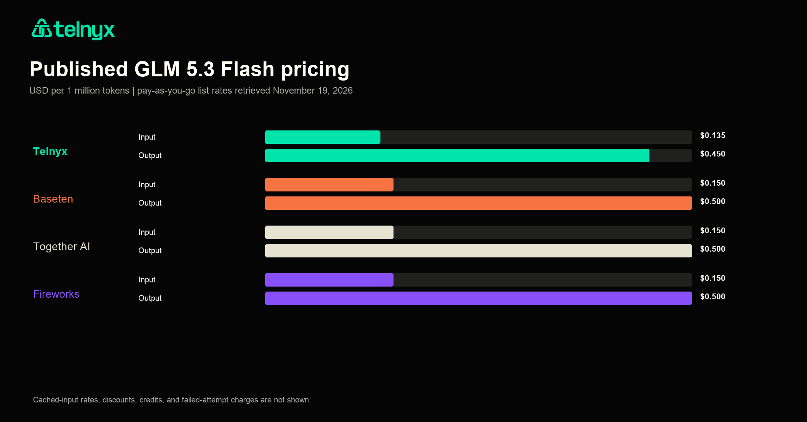

# GLM 5.3 Flash weekly provider benchmark

## Executive summary

This pilot compared GLM 5.3 Flash on Telnyx, Baseten, Together AI, and Fireworks from the same Telnyx Stateful Actor request origin. Every provider received the same six Moby-Dick prompt profiles, explicit `reasoning_effort=low`, deterministic sampling, streaming, and the same completion limits.

The primary run recorded **221/240 HTTP-successful requests**. After any targeted retries, **221/240 planned slots** had an HTTP-successful response and **221/240** reached visible answer content. Transport reliability, first model activity, first visible answer, completed-response latency, output speed, and estimated list-price cost are reported separately.

## Overall results

| Provider | Original HTTP | Visible answers | p50 TTFT | p50 TTFA | p50 E2E | Observed p95 E2E | p50 output speed | Est. token cost |
|---|---|---|---|---|---|---|---|---|
| Telnyx | 60/60 | 60/60 | 0.67s | 0.93s | 5.73s | 13.56s | 156.7 tok/s | $0.289 |
| Baseten | 41/60 | 41/60 | N/A* | N/A* | N/A* | N/A* | N/A* | N/A* |
| Together AI | 60/60 | 60/60 | 0.29s | 0.44s | 5.51s | 9.23s | 195.8 tok/s | $0.322 |
| Fireworks | 60/60 | 60/60 | 1.01s | 1.15s | 7.76s | 13.54s | 123.5 tok/s | $0.321 |

**Definitions:** TTFT is time to first model activity. TTFA is time to first visible answer content. E2E ends when the streamed response completes. TTFA, E2E, and output-speed percentiles use answer-complete requests only. The p95 values are observed sample percentiles, not provider SLAs.

`*` Baseten's pooled metrics and total cost are withheld because the benchmark account's GLM 5.3 Flash limit was 100K tokens per minute, constraining its 100K-input cells. The 41/60 figure is observed completion under that account quota, not a provider uptime measurement. Its valid per-workload measurements remain in the detailed table.

## Results by workload

| Workload | Provider | HTTP n | Answered n | p50 TTFA | p50 E2E | Observed p95 E2E | p50 tok/s |
|---|---|---|---|---|---|---|---|
| 1K input / short answer | Telnyx | 10/10 | 10/10 | 0.38s | 1.05s | 1.56s | 181.7 |
| 1K input / short answer | Baseten | 10/10 | 10/10 | 0.22s | 1.58s | 2.28s | 78.7 |
| 1K input / short answer | Together AI | 10/10 | 10/10 | 0.17s | 0.71s | 0.79s | 206.9 |
| 1K input / short answer | Fireworks | 10/10 | 10/10 | 0.88s | 1.84s | 2.47s | 113.7 |
| 1K input / long answer | Telnyx | 10/10 | 10/10 | 0.61s | 12.25s | 15.38s | 122.8 |
| 1K input / long answer | Baseten | 10/10 | 10/10 | 0.45s | 15.63s | 20.49s | 92.4 |
| 1K input / long answer | Together AI | 10/10 | 10/10 | 0.29s | 8.13s | 9.61s | 181.9 |
| 1K input / long answer | Fireworks | 10/10 | 10/10 | 0.93s | 12.49s | 13.30s | 117.6 |
| 10K input / short answer | Telnyx | 10/10 | 10/10 | 0.49s | 0.95s | 1.31s | 179.4 |
| 10K input / short answer | Baseten | 10/10 | 10/10 | 0.44s | 1.43s | 2.31s | 88.7 |
| 10K input / short answer | Together AI | 10/10 | 10/10 | 0.29s | 0.78s | 0.93s | 201.4 |
| 10K input / short answer | Fireworks | 10/10 | 10/10 | 1.13s | 1.84s | 2.61s | 140.5 |
| 10K input / long answer | Telnyx | 10/10 | 10/10 | 1.44s | 8.42s | 13.85s | 189.4 |
| 10K input / long answer | Baseten | 10/10 | 10/10 | 2.34s | 19.47s | 27.03s | 86.1 |
| 10K input / long answer | Together AI | 10/10 | 10/10 | 0.83s | 8.55s | 9.22s | 192.2 |
| 10K input / long answer | Fireworks | 10/10 | 10/10 | 1.92s | 13.27s | 14.36s | 120.5 |
| 100K input / short answer | Telnyx | 10/10 | 10/10 | 1.62s | 3.01s | 4.21s | 136.6 |
| 100K input / short answer | Baseten | 1/10 | 1/10 | 2.59s | 3.68s | 3.68s | 138.1 |
| 100K input / short answer | Together AI | 10/10 | 10/10 | 0.58s | 1.60s | 3.48s | 196.8 |
| 100K input / short answer | Fireworks | 10/10 | 10/10 | 1.66s | 2.91s | 4.35s | 133.5 |
| 100K input / long answer | Telnyx | 10/10 | 10/10 | 1.65s | 11.19s | 13.49s | 152.7 |
| 100K input / long answer | Baseten | 0/10 | 0/10 | N/A | N/A | N/A | N/A |
| 100K input / long answer | Together AI | 10/10 | 10/10 | 0.54s | 8.13s | 9.73s | 197.2 |
| 100K input / long answer | Fireworks | 10/10 | 10/10 | 0.85s | 12.25s | 14.60s | 126.9 |

## Reliability and retry accounting

- Planned primary attempts: **240**
- Primary HTTP successes: **221**
- Primary failures retained: **19**
- Retry attempts retained: **0**
- Failed retry attempts: **0**
- Reconciled HTTP-successful planned slots: **221**
- Answer-complete planned slots: **221**
- Unresolved planned failures: **19**
- Unresolved slots: **Baseten 100K input / short answer iteration 2, Baseten 100K input / short answer iteration 3, Baseten 100K input / short answer iteration 4, Baseten 100K input / short answer iteration 5, Baseten 100K input / short answer iteration 6, Baseten 100K input / short answer iteration 7, Baseten 100K input / short answer iteration 8, Baseten 100K input / short answer iteration 9, Baseten 100K input / short answer iteration 10, Baseten 100K input / long answer iteration 1, Baseten 100K input / long answer iteration 2, Baseten 100K input / long answer iteration 3, Baseten 100K input / long answer iteration 4, Baseten 100K input / long answer iteration 5, Baseten 100K input / long answer iteration 6, Baseten 100K input / long answer iteration 7, Baseten 100K input / long answer iteration 8, Baseten 100K input / long answer iteration 9, Baseten 100K input / long answer iteration 10**

- Baseten 100K input / short answer: 9 original HTTP 429 failure(s).
- Baseten 100K input / long answer: 10 original HTTP 429 failure(s).

The Baseten account used for this benchmark showed limits of 15 requests per minute and 100K tokens per minute for GLM 5.3 Flash. Its first successful 100K request reported 88,861 total tokens. The subsequent `rate_limit_exceeded` responses are therefore categorized as account-quota constrained, not as evidence of provider serving downtime.

Retries fill only failed planned slots in the reconciled dataset. They do not alter the original reliability rate, and every original failure remains in `raw-measurements.csv`.

## Cost scope

Published pay-as-you-go list rates were retrieved on November 19, 2026. The cost column multiplies successful rows' provider-reported input and output tokens by those rates. It assumes uncached input because this run did not expose verified cached-token counts. It excludes credits, discounts, failed-attempt charges without usage, and non-token fees, so it is an estimate rather than an invoice.

## Methodology

- **Model parity:** Telnyx, Baseten, and Together used `zai-org/GLM-5.3-Flash`; Fireworks used its provider-specific endpoint for the same published checkpoint, `accounts/fireworks/models/glm-5p3-flash`.
- **Request origin:** all provider requests originated from one Telnyx Stateful Actor invoked through its `us-east-2` regional path. This identifies the runner location, not any provider's inference-serving data center.
- **Prompts:** six public-domain Moby-Dick profiles targeting approximately 1K, 10K, and 100K input with short and long answers; ten planned repetitions per provider/profile cell.
- **Settings:** `reasoning_effort=low`, temperature 0, streaming enabled, 1,024 completion tokens for short-answer profiles, and 4,096 for long-answer profiles.
- **Execution:** requests ran sequentially (`batchSize=1`). Provider order was fixed in this pilot rather than randomized, so changing provider load over time is a possible confounder. The scheduled weekly runner will randomize comparable cells.
- **Percentiles:** p50 is the median. Observed p95 uses linear interpolation over eligible requests in each cell. Failed/no-answer requests remain in reliability counts and are excluded from latency percentiles.
- **Throughput:** output tokens per second uses provider-reported token counts where available. Check `token_usage_source` before detailed cross-provider interpretation.

## Limitations

- This is a point-in-time observational benchmark, not an SLA.
- Cells with fewer than ten answered requests have weaker tail estimates and show their sample sizes in the table and charts.
- Baseten's 41/60 completion count reflects the tested account's 100K tokens-per-minute quota and must not be interpreted as provider uptime.
- Provider load, routing, implementation, and pricing can change independently.
- The Moby-Dick prompts measure serving behavior across controlled context sizes; they are not a general model-quality benchmark.

## Reproduction artifacts

- `config/run-request.json`: sanitized request configuration.
- `config/pricing-snapshot.json`: rates and source URLs used for cost estimates.
- `data/raw-measurements.csv`: all original and retry attempts with generated text removed.
- `data/clean-successful-requests.csv`: answer-complete planned slots used for TTFA, E2E, and output-speed summaries.
- `data/http-successful-requests.csv`: reconciled HTTP-successful planned slots, including any no-answer streams.
- `data/unresolved-failures.csv`: planned slots not recovered by retries.
- `data/cell-summary.csv` and `data/provider-summary.csv`: report inputs.
- `scripts/start_run.py`: run configuration builder.

## Sources

- [Telnyx inference pricing](https://telnyx.com/pricing/inference-api)
- [Telnyx inference models](https://developers.telnyx.com/docs/inference/models)
- [Telnyx Stateful Actors](https://developers.telnyx.com/docs/edge-compute/stateful-actors)
- [Baseten pricing](https://www.baseten.co/pricing/)
- [Together AI GLM 5.3 Flash](https://www.together.ai/models/glm-5-3-flash)
- [Fireworks GLM 5.3 Flash](https://fireworks.ai/models/fireworks/glm-5p3-flash)
